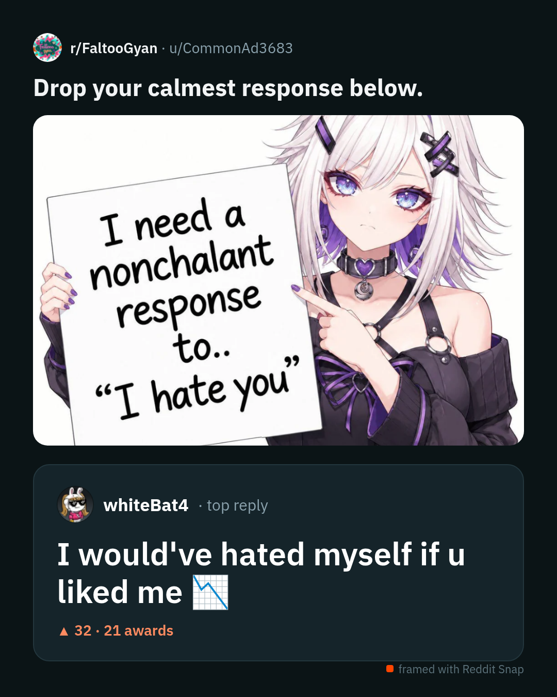

# Reddit Snap

**Turn a Reddit post and one comment into a single clean image, with one click.**

Reddit Snap is a Chrome extension that adds a **🖼 Frame** button under every comment on
reddit.com. Click it and you get a ready-to-share PNG: the post's title and image on top,
the comment you picked underneath, big and readable. No cropping two screenshots, no
Reply/Share buttons in the way.

<p align="center">
  
</p>

## Why

Sharing a good Reddit comment usually means two screenshots, manual cropping, and an image
full of buttons and ads. Reddit Snap builds the image from the post's data instead, so the
result is always clean and the comment, which is the part people actually want to share,
is the hero.

## Features

- **One click from Reddit.** A Frame button on every comment, plus a right-click
  "Frame this comment" fallback.
- **Never crops the post image.** Tall memes and comparison images show in full.
- **Two sizes.**
  - *Full image* (default): 1080 px wide, as tall as the content needs.
  - *Instagram 4:5*: exactly 1080 × 1350; long text shrinks to fit, the image is letterboxed rather than cut.
- **Context on demand.** Optionally include the parent comments or the first few replies.
- **Download PNG** or **Copy to clipboard**, ready to paste into WhatsApp, Instagram, X or Slack.
- **Works with your login.** Anything you can see on Reddit (including NSFW or
  quarantined posts you have opted into) can be framed.
- **No servers, no tracking.** Everything runs in your browser.

## Install

Reddit Snap is not on the Chrome Web Store yet, so you install it in developer mode. It
takes about a minute.

1. **Download the code.**
   - With git: `git clone https://github.com/buddhiraz/reddit-snap.git`
   - Or click **Code → Download ZIP** on this page and unzip it.
2. Open **`chrome://extensions`** in Chrome (or Edge, Brave and other Chromium browsers).
3. Turn on **Developer mode** (toggle in the top-right corner).
4. Click **Load unpacked** and select the `reddit-snap` folder (the one containing `manifest.json`).
5. Optional: pin the extension from the puzzle-piece menu so you can see it's active.

**Updating:** pull or re-download the code, then click the **↻ reload** icon on the
Reddit Snap card in `chrome://extensions`. Refresh any open Reddit tabs.

## How to use

1. Open any post on **www.reddit.com**.
2. Under the comment you want, click **🖼 Frame**.
   - Don't see the button? Right-click on the comment text and choose **Frame this comment**.
3. A preview tab opens. Adjust it if you like:

   | Option | What it does |
   |---|---|
   | **Size** | *Full image* (no cropping, height grows) or *Instagram 4:5* (1080 × 1350) |
   | **Include parent comments** | Adds the comments above it as short context lines |
   | **Include direct replies** | Adds up to 3 replies under the comment |
   | **Show vote counts** | Shows or hides the ▲ score |

4. Click **Download PNG**, or **Copy to clipboard** and paste it anywhere.

Your size choice is remembered for next time.

## How it works

```
reddit.com tab                      extension                          preview tab
┌──────────────────┐  click Frame  ┌───────────────┐  opens  ┌──────────────────────────┐
│ content.js       │ ────────────▶ │ background.js │ ──────▶ │ frame.html / frame.js    │
│ • adds buttons   │   post +      │ • stores data │         │ • renders the card       │
│ • reads Reddit's │   comment     │ • opens tab   │         │ • inlines images         │
│   .json API      │   data        └───────────────┘         │ • exports PNG (2× scale) │
└──────────────────┘                                         └──────────────────────────┘
```

- **content.js** watches the page for comments, adds the Frame button, and on click fetches
  `/comments/<post>/_/<comment>.json?context=8` plus author avatars. This is the same data
  reddit.com itself uses, requested with your normal login.
- **background.js** keeps the data in session storage and opens the preview tab.
- **frame.js** draws the card as plain HTML, turns every image into an inline data URL (so
  the export isn't blocked by cross-origin rules) and saves it with
  [html-to-image](https://github.com/bubkoo/html-to-image) at 2× for sharp text.
- Comment text is **sanitised**: only basic formatting is kept, links become plain text, and
  only images from Reddit's own domains are loaded.

## Permissions

| Permission | Why it's needed |
|---|---|
| `www.reddit.com` | Add the Frame button and read the post/comment data |
| `*.redd.it`, `*.redditmedia.com`, `*.redditstatic.com` | Load post images, avatars and emotes for the export |
| `storage` | Pass data from the Reddit tab to the preview tab (session only) |
| `contextMenus` | The right-click "Frame this comment" fallback |
| `clipboardWrite` | The Copy to clipboard button |

Nothing is sent anywhere except Reddit's own servers.

## Troubleshooting

| Problem | Fix |
|---|---|
| No Frame button | Reload the extension, then refresh the Reddit tab. Still missing? Use right-click → **Frame this comment**. |
| "Could not identify this comment" | You're probably on **old.reddit.com**; switch to www.reddit.com. |
| Post image missing in the export | Video posts use their thumbnail; some external links have no preview image at all. |
| Text looks cut off in 4:5 mode | Switch Size to **Full image** for very long comments. |
| Copy to clipboard fails | Click inside the preview tab first; browsers only allow clipboard access from a focused page. |

## Limitations

- New Reddit (www.reddit.com) only. old.reddit.com and the mobile apps aren't supported.
- Galleries use the first image; videos use their thumbnail.
- Chromium browsers only for now (Chrome, Edge, Brave, Arc). Firefox is not packaged yet.

## Project structure

```
manifest.json      Extension manifest (MV3)
content.js/.css    Runs on reddit.com: Frame button, data fetching
background.js      Service worker: storage hand-off, context menu
frame.html/.js/.css  Preview + export page (the card design lives here)
vendor/            html-to-image (MIT) and IBM Plex Sans (OFL), bundled locally
icons/             Extension icons
docs/              README images
```

No build step: edit the files, then reload the extension in `chrome://extensions`.

## Contributing

Issues and pull requests are welcome. Good first areas: Firefox support, a light theme, and
gallery support (choosing which image to show).

Please be considerate when sharing what you make: framed images show real people's
usernames and posts.

## Credits

- [html-to-image](https://github.com/bubkoo/html-to-image) (MIT) for the PNG export
- [IBM Plex Sans](https://github.com/IBM/plex) (SIL Open Font License 1.1)

Not affiliated with or endorsed by Reddit, Inc.

## License

[MIT](LICENSE)
